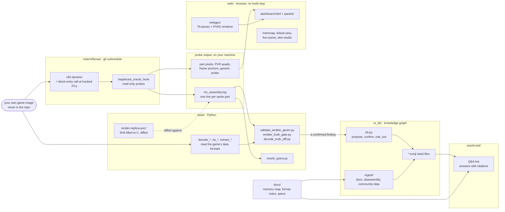
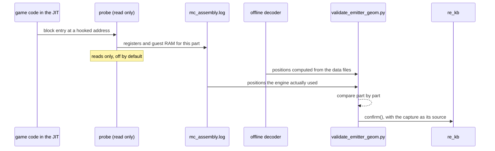

# MvC2 Oracle floorplan

A map of this repository for someone opening it cold: what the pieces are, how a fact travels from the
running game into the knowledge base, and where to start reading.

Written against `master` at `ff0ed4a`. Every statement points at a file you can open. Nothing derived from
a game image is in this repository, so the map describes tools and notes, not game data.

## 1. What this is

A toolkit for reverse-engineering *Marvel vs. Capcom 2* on the Sega NAOMI and Dreamcast (SH4 CPU). It
answers one kind of question: what does the game's own code do with this byte, on this frame?

It gets there by treating the running game as the source of truth. A read-only probe is compiled into an
emulator's JIT, the probe writes what the game computed, and every decoder and note in the repository is
checked against that output. The name comes from that: the game is the oracle.

## 2. The floorplan

## 3. The rooms

| Room | Path | What it holds |
|---|---|---|
| Emulator | `extern/flycast/` | A git submodule pinned to a flycast fork that already carries the hook. `scripts/apply-hook.sh` does not patch anything; it verifies the pinned commit has the hook and the two JIT edits. |
| Hook notes | `hook/`, `patch/` | Descriptions of the hook as a standalone extraction: one module under `core/network/` and two small edits, one in the x64 recompiler and one in the SH4 decoder. The code itself lives in the submodule. |
| Scripts | `scripts/` | `build-headless.sh` builds the emulator, `capture.sh` runs it with one probe switched on, `setup-from-rom.sh` decodes everything from your own image into ignored folders and refuses an image stored inside the repository. |
| Tools | `tools/` | About thirty Python scripts. Decoders for the game's sprite formats (`extract_gfx1_atlas.py`, `rip_gfx2_assembly.py`, `gfx1_lzss.py`), rippers for stages and HUD, and the checkers that compare decoder output with probe output. |
| Lift proof | `tools/render-replica-poc/` | A proof of concept that translates the game's sprite body walker from SH4 to C mechanically and compares the result with the engine. Its README records which routines matched bit for bit. |
| Knowledge graph | `re_kb/` | 92 SurrealDB seed files plus `kb.py`. Each finding is a row with a note, a status and a source. This copy is a mirror of a graph kept in the emulator fork; `scripts/sync-re-kb.sh --check` reports drift. |
| Dashboard | `web/` | Static pages that load a recorded capture and let you pause, step and scrub frames, with a struct inspector and an overlay that shows decoder output against probe output. `web/webgpu/` is a tile-accelerator parser and a PVR2 renderer in WebGPU. |
| Bot | `oracle-bot/` | A question-answering bot grounded in the seed files, the docs and the public disassembly. It cites a file and line for each claim and labels each one confirmed or inferred. |
| Notes | `docs/` | The memory map, the sprite format notes, the Frame Oracle specification, and plans. `docs/re-catalog/` is the object-pool catalog, worked through one character first. |

## 4. How a fact gets recorded

The method matters more than any one tool, so here is one fact followed end to end: where the game puts
each part of a character sprite on screen.

1. **The hook.** When a probe environment variable is set, the recompiler emits one extra call at the
   start of a chosen block, and the decoder is told to start a block at that address. The handler reads
   CPU registers and guest memory and appends a line to a file. It never writes to the guest. With no
   variable set the emulator is unchanged. The table of probes and the addresses they sit on is in
   `README.md`.
2. **The headline probe.** `ASMTRACE` sits where the game's body walker finishes placing one part, and
   writes one line per part: frame, sprite, part, offsets, the running pen position, final screen
   position, palette and flip. That is the engine's own answer.
3. **The decoder.** `tools/rip_gfx2_assembly.py` computes the same positions offline from the character
   data file.
4. **The check.** `tools/validate_emitter_geom.py` and `tools/emitter_truth_gate.py` compare the two. A
   decoder is trusted when it matches the probe, not when its output looks right.
5. **The record.** The finding goes into `re_kb/` through `kb.py`. `confirm()` requires a source that is
   a reproduction or the code itself, which is what stops a guess from being stored as a fact.

The README calls this the five-source workflow: check the graph and docs first, then decoded data, then
community notes, then the public disassembly, and use the live probe last as the tiebreaker.

## 5. How it is checked

| Check | Where | What it compares |
|---|---|---|
| Geometry | `tools/validate_emitter_geom.py` | Offline sprite assembly against the probe's per-part log. |
| Truth gate | `tools/emitter_truth_gate.py`, `tools/decode_truth_diff.py` | Decoded parts against what the engine decoded. |
| Lifted code | `tools/render-replica-poc/` | C translated from SH4 against the engine's output, including the one opcode that needed special handling. |
| Baked images | `tools/diag_baked_rom.py` | An edited data track against its untouched backup, validated the strict way the game's own decoder reads it. |
| Graph hygiene | `re_kb/audit_seeds.py`, `scripts/sync-re-kb.sh --check` | That a finding marked confirmed cites a reproduction or the code, and that the mirror matches its source. |

There is no CI in this repository. The checks are run by hand against a capture, because every one of them
needs data from a game image that cannot be committed.

## 6. Where to start reading

- No emulator, sixty seconds: `web/dashboard.html` with a recorded capture, as described in `README.md`.
- The method: this file's section 4, then the probe table in `README.md`.
- The sprite format: `docs/MARVELOUS2-GFX-NOTES.md`, then `tools/extract_gfx1_atlas.py` and
  `tools/rip_gfx2_assembly.py`.
- What is known: `docs/MVC2-MEMORY-MAP.md`, then `re_kb/README.md` for how to query the graph.
- The lift experiment: `tools/render-replica-poc/README.md`.
- Rules for contributing without committing game data: `CONTRIBUTING.md`.

## 7. What is not in this map

The emulator itself, which is upstream flycast plus the hook. The public disassembly and the community
data the notes cite, which are referenced and not copied. And anything that comes out of a game image:
decoded sprites, captures and probe logs are written to ignored folders on your own machine.
