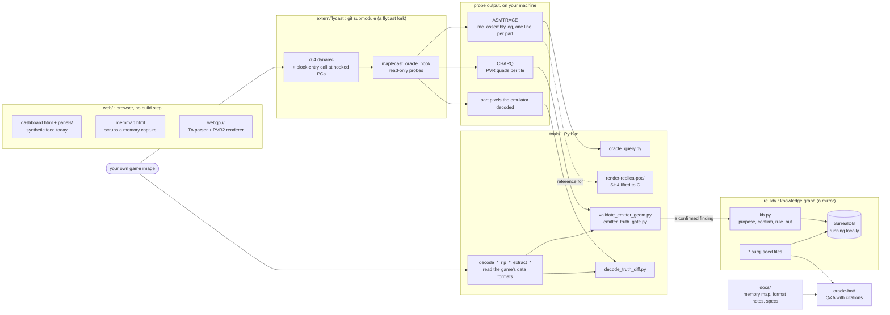
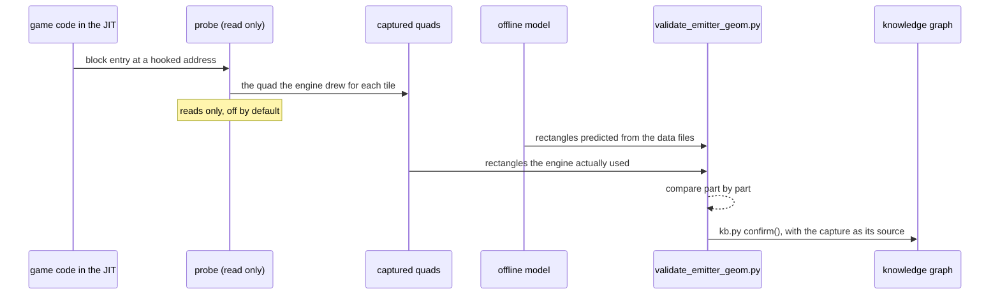

# MvC2 Oracle floorplan

A map of this repository for someone opening it cold: what the pieces are, which of them work today, how a
fact about the game gets checked and recorded, and where to start reading.

Written against `master` at `ff0ed4a`. Every statement points at a file you can open. Where the top-level
`README.md` describes something that is planned and not yet wired, this file says so.

## 1. What this is

A toolkit for reverse-engineering *Marvel vs. Capcom 2* on the Sega NAOMI and Dreamcast (SH4 CPU). It
answers one kind of question: what does the game's own code do with this byte, on this frame?

It gets there by treating the running game as the source of truth. A read-only probe is compiled into an
emulator's JIT, the probe writes what the game computed, and decoders and notes are checked against that
output. The name comes from that: the game is the oracle.

The repository's rule (`CONTRIBUTING.md`) is that you bring your own game image and nothing decoded from
it is committed. Two kinds of derived metadata are shipped on purpose: the animation catalogs in
`web/anim/` and the generated seeds under `re_kb/ingest/generated/`.

## 2. The floorplan

## 3. The rooms

| Room | Path | What it holds, and its state |
|---|---|---|
| Emulator | `extern/flycast/` | A git submodule pinned to a flycast fork that already carries the hook, along with that fork's other additions. `scripts/apply-hook.sh` patches nothing; it verifies the pinned commit has the hook module and the two JIT edits. |
| Hook notes | `hook/`, `patch/` | Notes only. `hook/README.md` describes the hook module, and `patch/` holds two feature notes. The hook source lives in the submodule. Parts of these READMEs still describe an older copy-and-patch plan. |
| Scripts | `scripts/` | `build-headless.sh` builds the emulator. `capture.sh` runs it with one probe switched on. `sync-re-kb.sh` refreshes the knowledge graph mirror. `setup-from-rom.sh` refuses an image stored inside the repository and builds the emulator; its decode, seed and capture steps are placeholders today. |
| Tools | `tools/` | About thirty Python scripts. Decoders for the game's sprite formats (`extract_gfx1_atlas.py`, `rip_gfx2_assembly.py`, `gfx1_lzss.py`), rippers for stages and HUD, tools that write an edited sprite back into a disc image, and the checkers in section 5. |
| Lift proof | `tools/render-replica-poc/` | A proof of concept that translates the game's sprite render routines from SH4 to C mechanically, runs them, and compares the output with the engine. Its README records which routines matched bit for bit. It builds with MSVC on Windows; the rest of the repository targets Linux or WSL2. |
| Knowledge graph | `re_kb/` | 92 SurrealDB seed files plus `kb.py`. This copy is a mirror; the graph that leads is kept in the emulator fork. It can lag well behind, so run `scripts/sync-re-kb.sh --check` before trusting it. |
| Browser pages | `web/` | Static pages. `dashboard.html` shows the struct panels and inspector, driven today by a synthetic feed (`linked-source-synthetic.mjs`), with pause and step. `memmap.html` scrubs a recorded memory capture. `web/webgpu/` is a tile-accelerator parser and a PVR2 renderer in WebGPU. The capture-driven dashboard described in `README.md` is not built yet. |
| Bot | `oracle-bot/` | A question-answering bot grounded in the seed files, the docs and the public disassembly. It cites a file and line for each claim and labels each one confirmed or inferred. |
| Notes | `docs/` | The memory map, the sprite format notes, the Frame Oracle specification, and plans. `docs/re-catalog/` is the object-pool catalog, worked through one character first. |

## 4. How a fact gets checked and recorded

The method matters more than any one tool. Here it is for one question: where does the game put each part
of a character sprite on screen?

1. **The hook.** When a probe environment variable is set, the recompiler emits one extra call at the
   start of a chosen block, and the decoder is told to start a block at that address. The handler reads
   CPU registers and guest memory and appends to a file. It does not write to the guest. With no variable
   set the emulator behaves as before. The main probes and the addresses they sit on are in `README.md`.
2. **Two views of the same thing.** `ASMTRACE` sits where the game's body walker finishes placing one part
   and writes one line per part, including the running pen position and the final screen position.
   `CHARQ` captures the quad the engine submitted for each tile. `tools/oracle_query.py` reads the first;
   the checkers read the second.
3. **The offline model.** `tools/rip_gfx2_assembly.py` builds the cumulative pen offsets for each sprite
   from the extracted character data. Turning those into screen positions also needs the object's anchor
   and scale at run time.
4. **The check.** `tools/validate_emitter_geom.py` compares predicted rectangles with captured quads, part
   by part. `tools/emitter_truth_gate.py` goes further and overlays pixels at both sets of positions.
   `tools/decode_truth_diff.py` is the separate check for pixel decoding: the offline GFX1 decode against
   the part pixels the emulator itself decoded. A decoder is trusted when it matches the engine, not when
   its output looks right.
5. **The record.** A finding is written through `re_kb/kb.py` to a running SurrealDB. `confirm()` requires a
   source that is a reproduction or the code itself, which is what stops a guess from being stored as a
   fact. Findings belong in the graph in the emulator fork and reach this mirror through the sync script.

`README.md` calls the wider habit the five-source workflow: check the graph and docs first, then decoded
data, then community notes, then the public disassembly, and use the live probe last as the tiebreaker.

## 5. How it is checked

| Check | Where | What it compares |
|---|---|---|
| Geometry | `tools/validate_emitter_geom.py` | Predicted part rectangles against captured `CHARQ` quads. |
| Geometry and pixels | `tools/emitter_truth_gate.py` | The same atlas pixels placed at predicted and at captured positions, with a tolerance on both. |
| Decode | `tools/decode_truth_diff.py` | Offline part decode against the emulator's own decoded part pixels. |
| Lifted code | `tools/render-replica-poc/` | C translated from SH4 against the engine's output, with `ASMTRACE` as the reference for screen positions. |
| Baked images | `tools/diag_baked_rom.py` | An edited data track against its untouched backup, validated the strict way the game's own decoder reads it. |
| Graph hygiene | `re_kb/audit_seeds.py`, `scripts/sync-re-kb.sh --check` | That a finding marked confirmed cites a reproduction or the code, and that the mirror matches its source. |

Limits worth knowing before relying on these:

- There is no CI. Everything is run by hand.
- The geometry, pixel and decode checks are written for one character and read capture files from fixed
  local folders (`_ryu_capture/`, `web/test-atlas/`). No script in this repository produces those files
  yet, so the checks cannot be rerun from a clean clone.

## 6. Where to start reading

- The method: section 4 here, then the probe table in `README.md`.
- The sprite format: `docs/MARVELOUS2-GFX-NOTES.md`, then `tools/extract_gfx1_atlas.py` and
  `tools/rip_gfx2_assembly.py`.
- What is known: `docs/MVC2-MEMORY-MAP.md`, then `re_kb/README.md` for how to start the database and query
  the graph.
- The lift experiment: `tools/render-replica-poc/README.md`.
- Something on screen without an emulator: serve `web/` with any static server and open `dashboard.html`
  for the synthetic demo.
- Rules for contributing without committing game data: `CONTRIBUTING.md`.

## 7. What is not in this map

The emulator, which is a fork of flycast with more in it than this hook. The public disassembly the notes
cite, which is referenced and not copied. And the output of a game image: decoded sprites, captures and
probe logs are meant to stay in ignored folders on your own machine.
